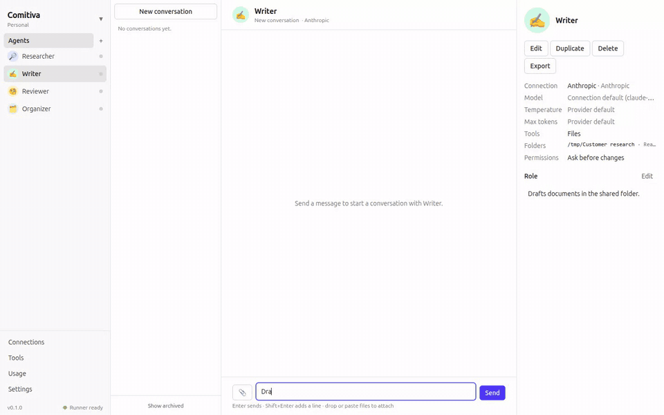
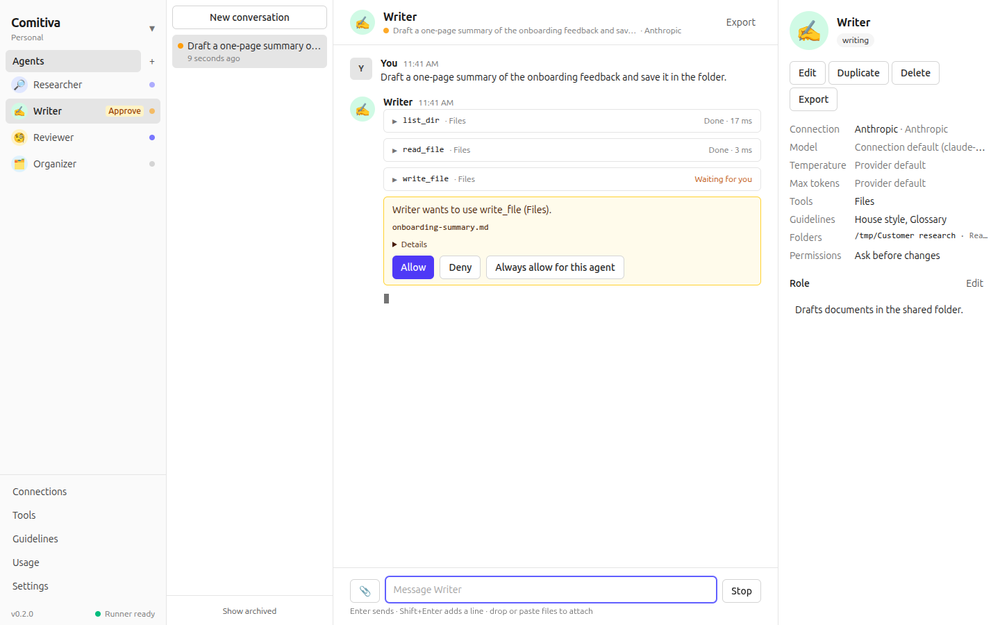
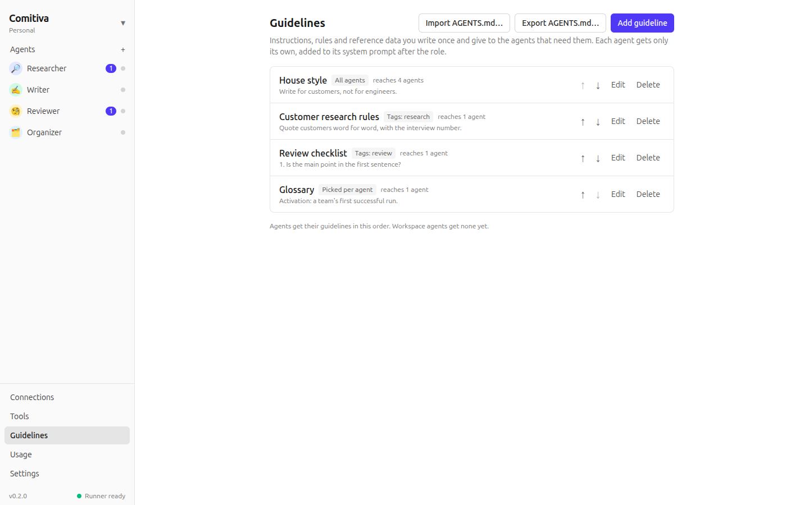
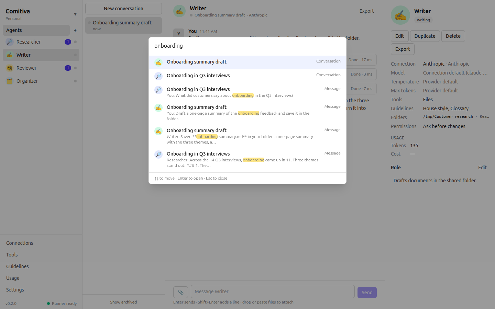

# Comitiva

**Agentic chat for your whole team.**

> [!IMPORTANT]
> **Comitiva is an early-stage open source project, in development and testing.** It works and is tested end to end, but it is young: expect rough edges and changes between versions, keep copies of files you let agents change, and tell us what breaks ([issues](https://github.com/comitiva-dev/comitiva/issues)). The installers for Windows and macOS are not signed yet.

**What it is.** A desktop app where you set up a small team of AI agents, each with a job, a model and the files and tools it may use, and talk to all of them in one chat, the way you talk to colleagues in Slack.

**Why.** Using AI for real work today means one window per provider, pasting the same instructions again and again, and copying files in and out by hand. In Comitiva you define an agent once: a Researcher that reads your notes folder, a Writer that drafts in your Google Drive in your house style, a Reviewer with your checklist. Each one uses the model you choose, from an API key or the Claude Code and Codex logins you already have. They work at the same time, ask you before they change a file, and you see what each one costs. With a [hub](https://github.com/comitiva-dev/hub), your team shares the same agents and conversations.

It is not a coding tool. Agents research, write, review and organize files; code is just one case.

<p align="center">
  
</p>

> **Status: v0.2.0, early development**: macOS, Windows and Linux, and workspaces for teams on a self-hostable [hub](https://github.com/comitiva-dev/hub). Guidelines are in `main` for the next release. A web UI and agents run by the hub come next ([roadmap](CONTRIBUTING.md#roadmap)).

## What it does

- **Any model, one chat.** Connect API keys or the CLI harnesses you already use with their own login. Each agent picks a connection and a model; many agents answer at the same time.
- **Agents with a role and tools.** Give an agent folders (read, or read and write), your Google Drive, or any MCP server. Reading runs freely; anything that changes a file asks you first, inline, with Allow, Deny or Always allow. Paths outside the agent's folders are refused by the server itself.
- **Guidelines, written once** (next release). Keep your house style, rules and reference notes as guidelines, or import an `AGENTS.md` or `CLAUDE.md` (one guideline per `##` section). Give each one to every agent, to the agents with a tag, or to the agents that pick it. Each agent's prompt gets only its own guidelines, after its role ([ADR 0020](docs/adr/0020-guidelines.md)).
- **Attachments.** Paste a screenshot or drop text files into a message. Providers that cannot see images get the file name instead, and the composer tells you before you send.
- **Search everything.** Cmd/Ctrl+K jumps to an agent, a conversation or any message, full text, accents ignored.
- **Know what it costs.** Every run's tokens and cost, by connection, agent and model, with your own price corrections and a CSV export.
- **Yours to move.** Export a conversation as Markdown; export agents with their connections and tools as a file (never with keys) and import them elsewhere.
- **Local-first.** Everything stays on your computer in SQLite. Keys live in the OS keychain, never in the database.
- **Teams, optionally.** Connect to a [Comitiva hub](https://github.com/comitiva-dev/hub) to share agents and conversations in workspaces and watch replies stream in on everyone's screen. Each member runs agents with their own connection; keys and folders never leave their computer ([docs/hub.md](docs/hub.md)).
- **English and Português (Brasil)**, light and dark, keyboard shortcuts for everything (Cmd/Ctrl+/ lists them).

<picture>
  <source media="(prefers-color-scheme: dark)" srcset="docs/images/approval-dark.png">
  
</picture>

<picture>
  <source media="(prefers-color-scheme: dark)" srcset="docs/images/guidelines-dark.png">
  
</picture>

<picture>
  <source media="(prefers-color-scheme: dark)" srcset="docs/images/search-dark.png">
  
</picture>

## Install

Download the file for your system from the [latest release](https://github.com/comitiva-dev/comitiva/releases/latest).

| System | File | Notes |
|---|---|---|
| macOS (Apple silicon / Intel) | `Comitiva-…-mac-arm64.dmg` / `…-mac-x64.dmg` | The app is not signed yet: the first time, macOS blocks it; open **System Settings → Privacy & Security** and click **Open Anyway**. New versions are announced in the app with a download link. |
| Windows 10/11 | `Comitiva-…-win-x64-setup.exe` | Not signed yet: SmartScreen shows **More info → Run anyway**. Installs for your user; updates install on restart. |
| Linux (Debian, Ubuntu) | `.deb` | `sudo apt install ./Comitiva-…-linux-amd64.deb`. Updates install on restart. |
| Linux (Fedora, openSUSE) | `.rpm` | `sudo dnf install ./Comitiva-…-linux-x86_64.rpm` |
| Linux (any) | `.AppImage` | `chmod +x` it and run it. Updates itself. Where the system blocks user namespaces (Ubuntu 24.04+), it runs without Chromium's sandbox; the deb and rpm keep it. |

On Linux, Comitiva stores API keys in your keyring (GNOME Keyring or KWallet). Without a running keyring it refuses to save keys and says why; local models without a key still work.

## Getting started

1. **Connections → Add connection.** Pick a provider, paste a key (none for Ollama or LM Studio; Claude Code and Codex use their own login), press **Fetch models** or **Detect**, then **Test** and **Save**. Details per provider: [docs/providers.md](docs/providers.md).
2. **Agents → +.** Name it, pick the connection and a model, write its role. Under **Tools**, add folders or Google Drive and choose how much it may do without asking ([docs/tools.md](docs/tools.md)).
3. **Guidelines** (optional). Write what several agents should follow once, or import an `AGENTS.md`, and choose which agents get each one.
4. Talk to it. Start another agent in parallel; the sidebar shows who is responding, who needs your approval and what is unread.

## How it is built

```
Renderer (React) ──Backend──▶ Preload ──IPC──▶ Electron main ──JSON lines (stdio)──▶ Runner (Node) ──▶ LLM providers
                                                   │                                     │
                                          SQLite · safeStorage secrets             MCP servers (tools)
```

- **The runner is the product.** All LLM execution — adapters, streaming, cancellation, usage, the tool loop, MCP clients and approvals — lives in `packages/runner`, a plain Node process with its own JSON-lines protocol. Electron is one client of it.
- **Local-first.** SQLite for everything, the OS keychain for secrets.
- **Shared contract.** `packages/contract` holds zod schemas and the JSON Schema that the Laravel hub, in its own repository, copies at a tagged release ([ADR 0015](docs/adr/0015-hub-repositories-and-editions.md), [ADR 0016](docs/adr/0016-hub-contract-consumption.md)).

Read more in [SPEC.md](SPEC.md), [docs/architecture.md](docs/architecture.md), [docs/design.md](docs/design.md) and the [ADRs](docs/adr/).

| Path | Package | What |
|---|---|---|
| `packages/contract` | `@comitiva/contract` | Entities, blocks, runner protocol, IPC, the portable bundle; JSON Schema output |
| `packages/runner` | `@comitiva/runner` | The runner process, `RunnerClient`, provider adapters, pricing |
| `packages/mcp-servers` | `@comitiva/mcp-servers` | Built-in MCP servers: filesystem (with roots) and Google Drive |
| `apps/desktop` | `desktop` | The Electron app |

## Developing

```bash
corepack enable
pnpm install
pnpm dev                                   # Ubuntu 24.04+: pnpm dev -- --noSandbox
pnpm lint && pnpm typecheck && pnpm test   # all checks
pnpm --filter desktop test:e2e             # end to end, no API key needed (fake providers)
pnpm package                               # installers for your platform
```

Everything else — tests, debugging, packaging, signing, releasing — is in [docs/development.md](docs/development.md). To contribute, see [CONTRIBUTING.md](CONTRIBUTING.md).

## License

[Apache-2.0](LICENSE)
